# Ethernet to Laser (10BASE-T)

A full-duplex **free-space optical link for 10BASE-T Ethernet**. Each module plugs into a laptop with a normal Ethernet cable. It turns the laptop's transmit signal into laser light, and turns the light from the opposite module back into an Ethernet signal for the laptop. Two identical modules facing each other replace the cable between two computers.

The whole signal path is analogue and discrete: no PHY chip, no microcontroller, no firmware. The design was done in **Altium Designer**, with every stage tuned in **LTspice** first.

<p align="center">
  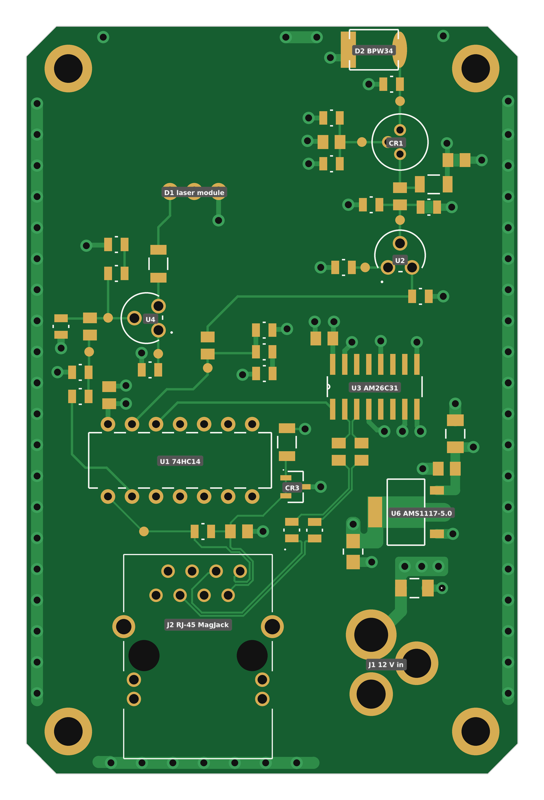
</p>

| | |
|---|---|
| **Data** | 10BASE-T Ethernet (10 Mb/s, Manchester-coded), full duplex |
| **Simulated with** | a 20 MHz test signal, twice the highest 10BASE-T tone |
| **Transmitter** | Laser diode module driven by a 2N3904 current sink, about 4 mA to 40 mA (simulated) |
| **Receiver** | BPW34 PIN photodiode, two discrete transistor gain stages, Schmitt-trigger slicer |
| **Ethernet side** | RJ-45 MagJack with built-in transformers, AM26C31 differential line driver |
| **Power** | Single 12 V input on a barrel jack; on-board 5 V LDO |
| **PCB** | 4 layers, 51.9 x 78.7 mm, all routing on the top layer |
| **Parts** | 56 placed parts (47 components and 9 test points) |

---

## Contents

- [How the link works](#how-the-link-works)
- [Hardware blocks, step by step](#hardware-blocks-step-by-step)
- [Simulation results](#simulation-results)
- [PCB](#pcb)
- [Bill of materials](#bill-of-materials)
- [Opening the project](#opening-the-project)
- [Repository layout](#repository-layout)
- [Status](#status)

---

## How the link works

Two identical modules face each other. Each module carries **one direction** of the Ethernet link on light, so the two beams together give full duplex.


Inside one module there are two independent lanes:

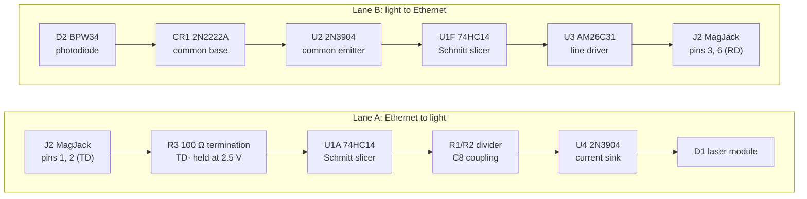

The board is wired like a **switch port**. It receives on RJ-45 pins 1 and 2 and transmits on pins 3 and 6, so a laptop connects with an ordinary straight-through cable.

Full schematic (one sheet, eight hardware blocks): [docs/images/schematic/full_schematic.png](docs/images/schematic/full_schematic.png)

<p align="center">
  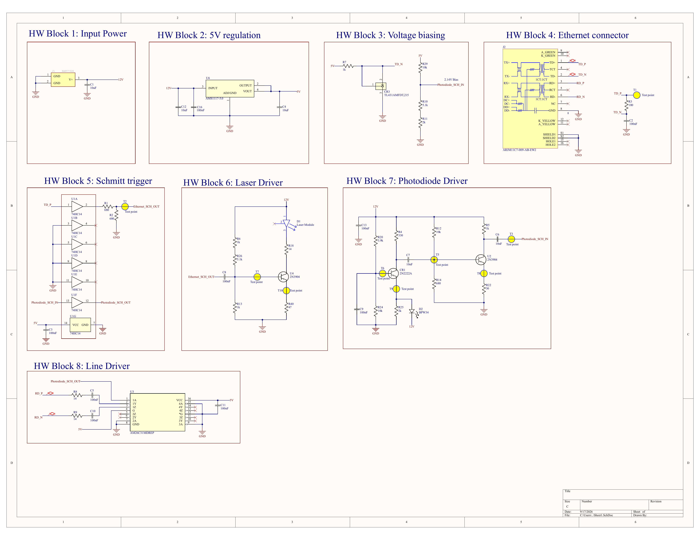
</p>

---

## Hardware blocks, step by step

The schematic is split into eight blocks. The numbers below match the block titles on the sheet.

### HW Block 1: Input power

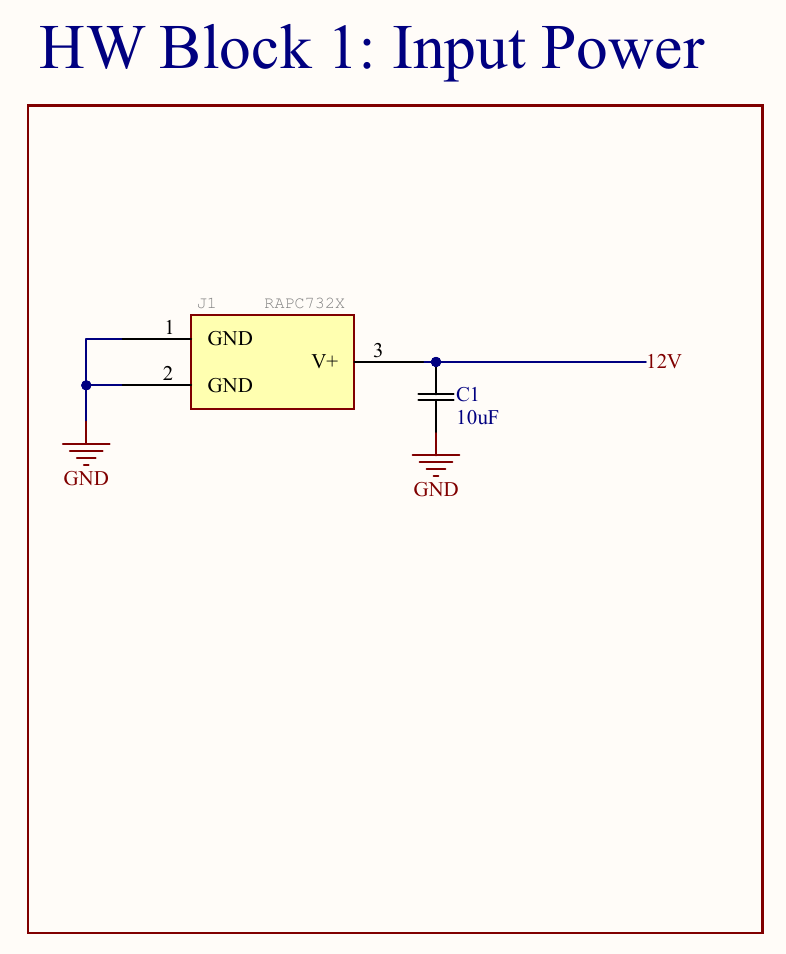

1. 12 V comes in on **J1**, a Switchcraft RAPC732X barrel jack.
2. **C1** (10 µF) stores charge right at the input to supply short current peaks.
3. The 12 V rail feeds the laser module, both receiver transistor stages and the 5 V regulator.

<br clear="right"/>

### HW Block 2: 5 V regulation

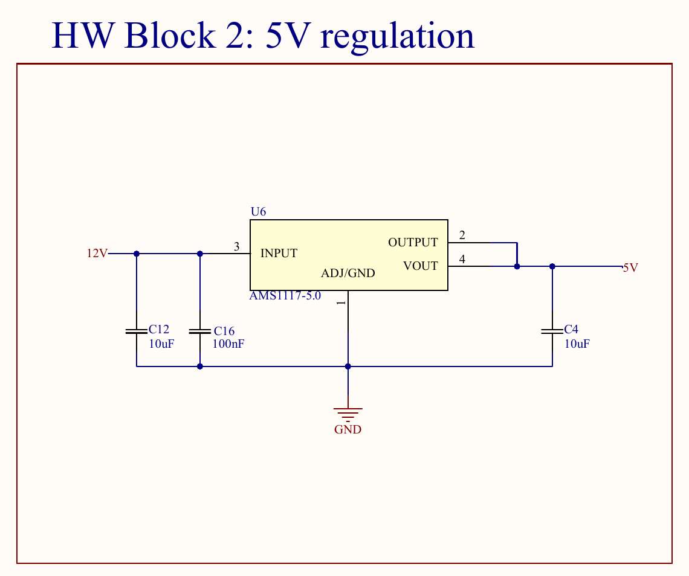

1. **U6**, an AMS1117-5.0 linear regulator, makes the 5 V rail from 12 V.
2. **C12** (10 µF) and **C16** (100 nF) decouple the input. **C4** (10 µF tantalum) keeps the regulator's output stable.
3. The 5 V rail supplies the logic (U1, U3) and the two bias networks of Block 3.

<br clear="right"/>

### HW Block 3: Voltage biasing

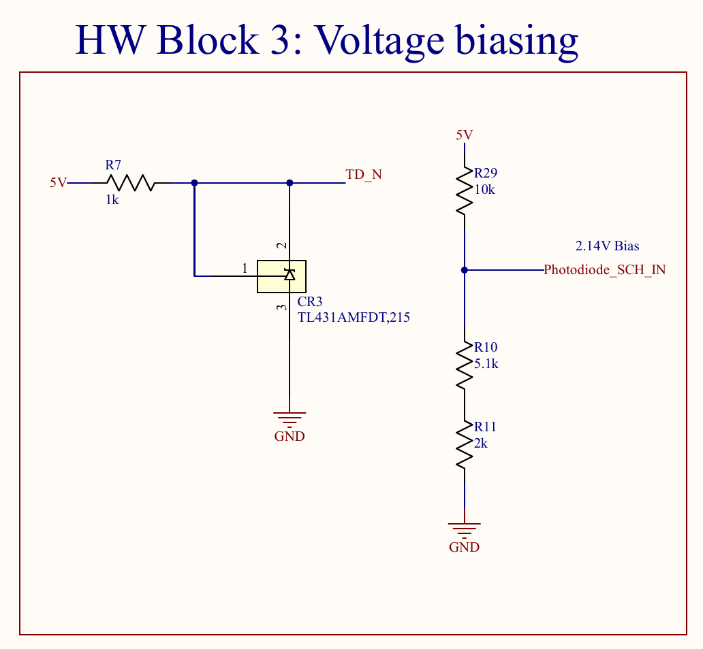

1. **CR3** is a TL431 shunt reference, wired with its REF pin tied to its cathode. In that connection it holds its cathode at its internal 2.5 V reference.
2. **R7** (1 kΩ) feeds it from 5 V, giving about (5 - 2.5) V / 1 kΩ = 2.5 mA of operating current.
3. The 2.5 V node is the net **TD_N**, the negative leg of the incoming Ethernet pair (Block 4).
4. Separately, **R29** (10 kΩ) and **R10 + R11** (5.1 kΩ + 2 kΩ) form a divider from 5 V. It gives 5 V x 7.1 / 17.1 = **2.08 V** on the net **Photodiode_SCH_IN**, the receiver slicer input.
5. This divider has **no capacitor to ground, on purpose**. A capacitor there would short the received signal arriving through C6 to ground.

<br clear="right"/>

### HW Block 4: Ethernet connector

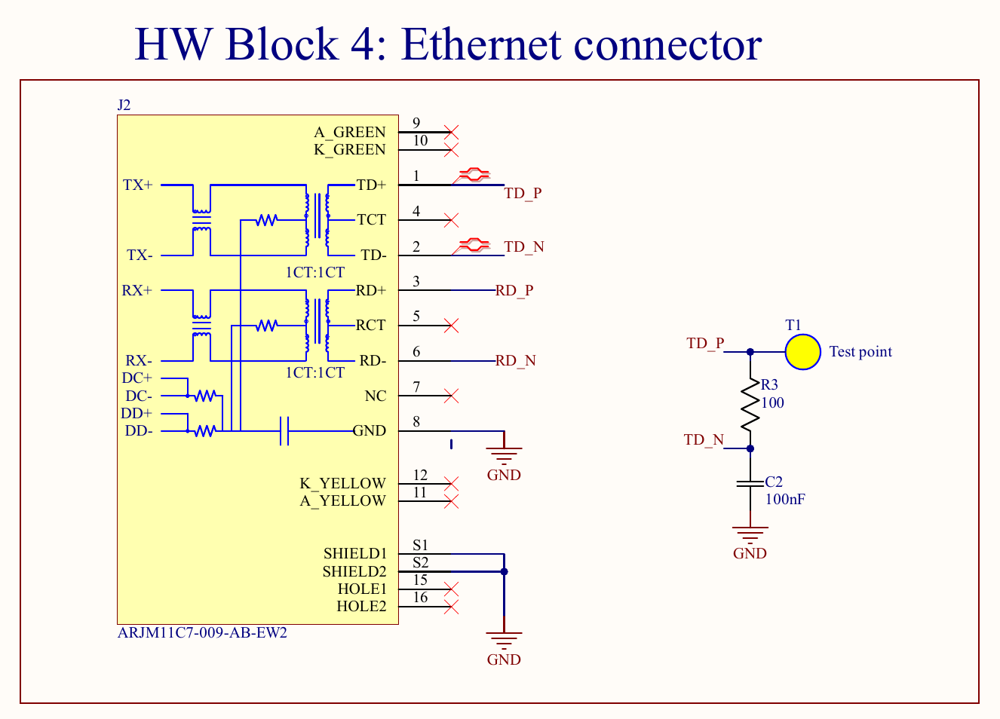

1. **J2** is an Abracon ARJM11C7-009-AB-EW2: an RJ-45 jack with the Ethernet isolation transformers built in.
2. The incoming pair (TD_P, TD_N) is terminated by **R3** (100 Ω), the characteristic impedance of Ethernet twisted pair.
3. TD_N sits at 2.5 V (Block 3) and is AC-grounded by **C2** (100 nF). TD_P therefore swings around 2.5 V by the full differential voltage of the pair.
4. The outgoing pair (RD_P, RD_N) comes from the line driver in Block 8.
5. The jack LEDs, centre taps and spare pins are left unconnected and marked No-ERC.

<br clear="right"/>

### HW Block 5: Schmitt trigger

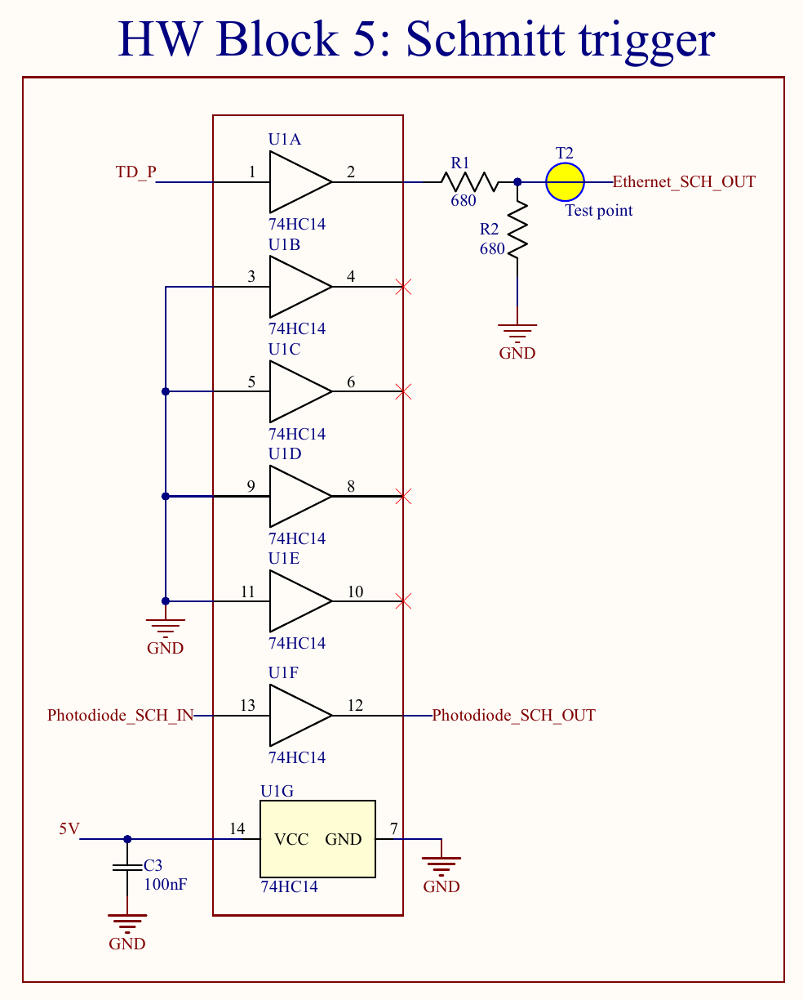

1. **U1** is a 74HC14 hex Schmitt-trigger inverter. Two of its six gates are used.
2. A Schmitt trigger switches high at one input threshold and low at a lower one (hysteresis). That turns a slow or noisy analogue wave into clean 0 V / 5 V logic without chattering.
3. **U1A** slices TD_P (centred on 2.5 V) into logic. That logic signal is the transmit data.
4. **R1 / R2** (680 Ω / 680 Ω) halve the 5 V logic swing to 2.5 V peak-to-peak. The result, **Ethernet_SCH_OUT**, goes to the laser driver.
5. **U1F** slices the received optical signal (Block 7). Its output, **Photodiode_SCH_OUT**, goes to the line driver.
6. The four unused gates have their inputs tied to ground, so they cannot float and oscillate. **C3** (100 nF) decouples U1's supply.

<br clear="right"/>

### HW Block 6: Laser driver

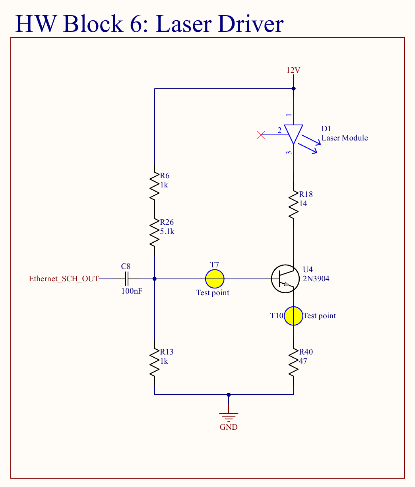

1. **C8** (100 nF) AC-couples Ethernet_SCH_OUT into the base of **U4**, a 2N3904. AC coupling passes the changes in the signal and blocks its DC level. The base keeps its own DC bias point.
2. That bias comes from **R6 + R26** (1 kΩ + 5.1 kΩ) from 12 V and **R13** (1 kΩ) to ground: 12 V x 1 / 7.1 = 1.69 V without load.
3. **R40** (47 Ω) in the emitter sets the current. The emitter sits one base-emitter drop (about 0.7 V) below the base, so collector current is about (V_base - 0.7 V) / 47 Ω. Moving the base voltage up and down moves the laser current up and down.
4. **D1**, the laser module, takes its supply from 12 V. Its return pin goes through **R18** (14 Ω) into U4's collector, so U4 acts as a controlled current sink under the laser.
5. **The laser is current-controlled by design.** The supply voltage left over above what the module needs drops across R18 and U4.
6. The laser is **never fully switched off**. In simulation the current swings between about 4 mA and 40 mA. Keeping a small current flowing avoids the delay and ringing a laser shows when it starts from zero.

<br clear="right"/>

### HW Block 7: Photodiode receiver

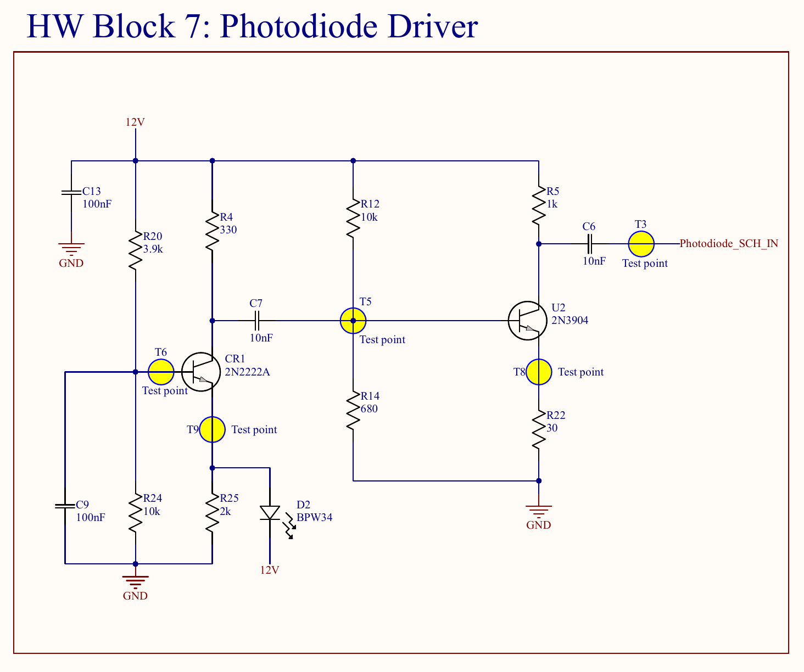

1. **D2**, a BPW34 PIN photodiode, has its cathode on 12 V and its anode on the emitter of **CR1** (2N2222A). Light makes it pass a current proportional to the optical power (the photocurrent).
2. **CR1 is a common-base stage**: its base is held still and the signal enters at the emitter.
   - **R20 / R24** (3.9 kΩ / 10 kΩ) set the base at 12 V x 10 / 13.9 = 8.6 V. **C9** (100 nF) holds it still at signal frequencies.
   - The emitter sits about 0.7 V lower, at about 7.9 V. **R25** (2 kΩ) therefore draws about 4 mA.
   - The photodiode sees 12 V - 7.9 V, about 4.1 V of reverse bias. Reverse bias lowers its capacitance, which makes it faster.
3. The emitter is a very low-impedance point, so the photodiode's capacitance barely slows the signal. That is why the photodiode feeds a common-base stage and not a resistor.
4. Any photocurrent entering the emitter node changes CR1's collector current by the same amount. **R4** (330 Ω) turns that change into a voltage.
5. **C7** (10 nF) couples this into **U2** (2N3904), a **common-emitter gain stage**. **R12 / R14** (10 kΩ / 680 Ω) bias the base, **R22** (30 Ω) is the emitter resistor and **R5** (1 kΩ) is the collector load. The voltage gain is roughly R5 divided by the emitter resistance.
6. **C6** (10 nF) couples the amplified signal onto the 2.08 V bias node from Block 3, where **U1F** (Block 5) slices it back into logic.

<br clear="right"/>

### HW Block 8: Line driver

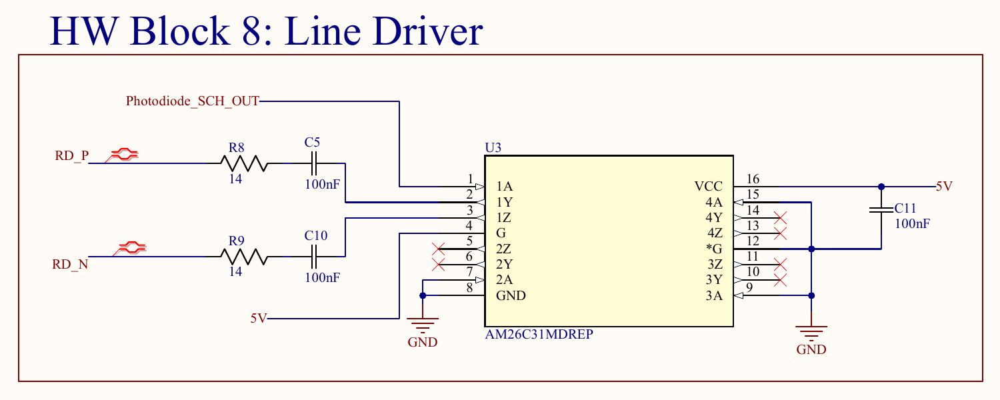

1. **U3**, a TI AM26C31 differential line driver, takes the logic signal Photodiode_SCH_OUT on input 1A.
2. It outputs the signal on **1Y** and its inverse on **1Z**. Together they form a differential pair, which is what Ethernet uses.
3. **C5 / C10** (100 nF) block DC. The transformer in J2 only passes the changing part of the signal.
4. **R8 / R9** (14 Ω) add series resistance on each leg. The pair then drives **RD_P / RD_N** (J2 pins 3 and 6) towards the laptop.
5. The enable pin G is tied to 5 V and G-bar to ground, so the driver is always on. The three unused inputs are grounded. **C11** (100 nF) decouples U3.

<br clear="right"/>

---

## Simulation results

All stages were simulated in LTspice before layout. The full set of circuits and waveforms is in [docs/Ethernet_to_Laser_Circuit_Stages_and_Simulation.pdf](docs/Ethernet_to_Laser_Circuit_Stages_and_Simulation.pdf).

| Laser current, I(D2): about 4 mA to 40 mA at 20 MHz | Receiver logic outputs after the slicer, 0 V to 5 V |
|---|---|
| 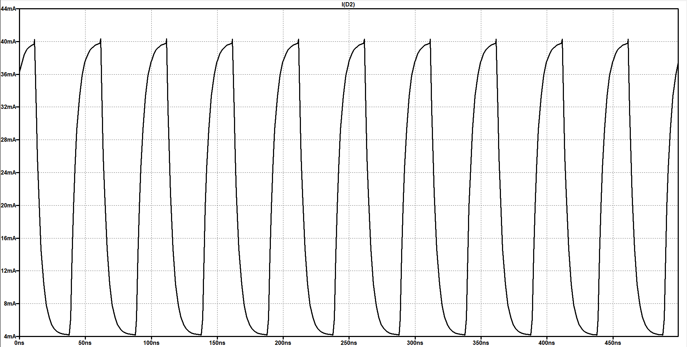 | 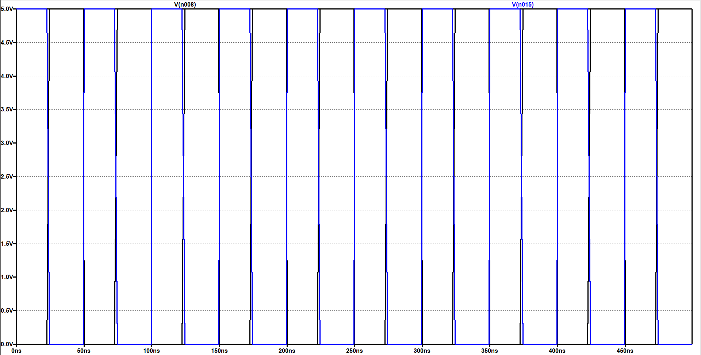 |
| **Input: differential signal from the laptop** | **Divider output to the laser driver** |
| 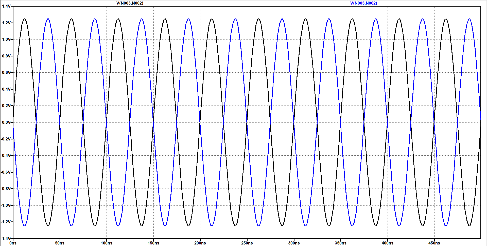 | 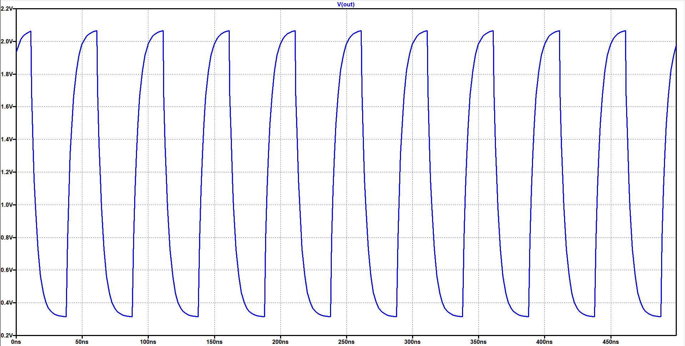 |
| **Receiver: first stage output (CR1 collector)** | **Receiver: second stage after AC coupling (slicer input)** |
| 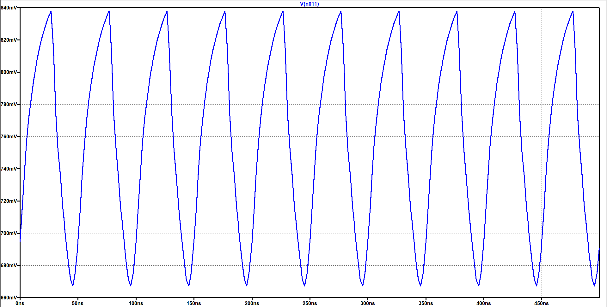 | 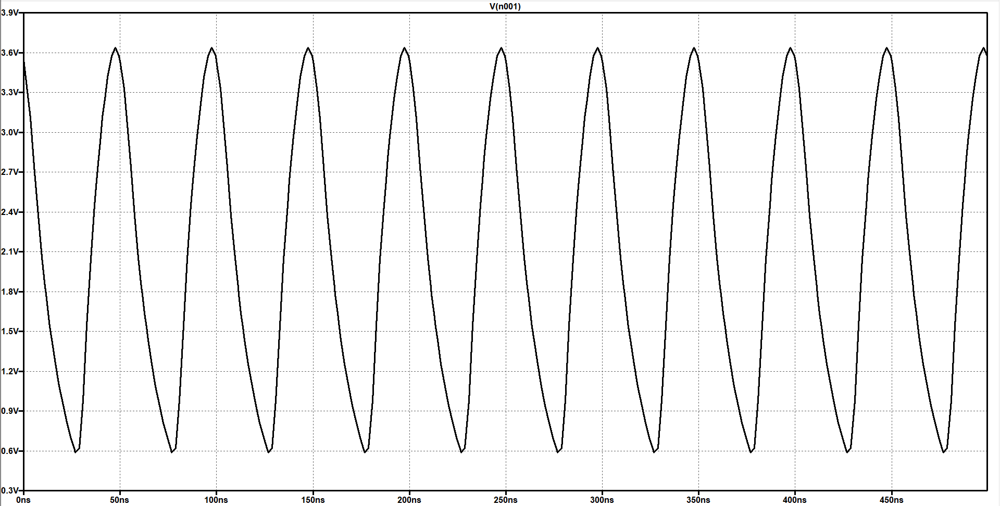 |

<details>
<summary>Simulation circuits</summary>

| Input conditioning | Laser driver | Receiver |
|---|---|---|
| 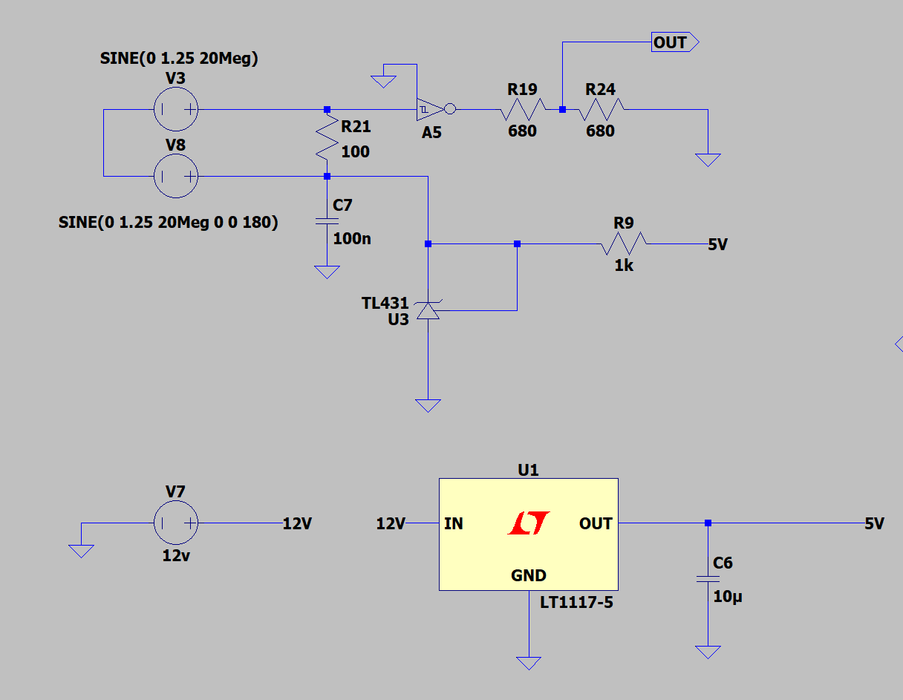 | 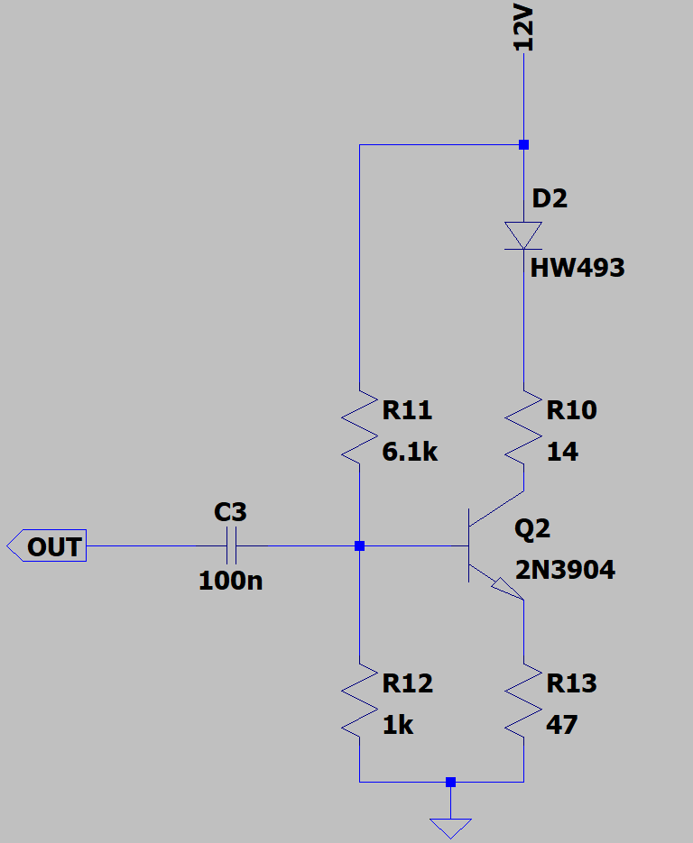 | 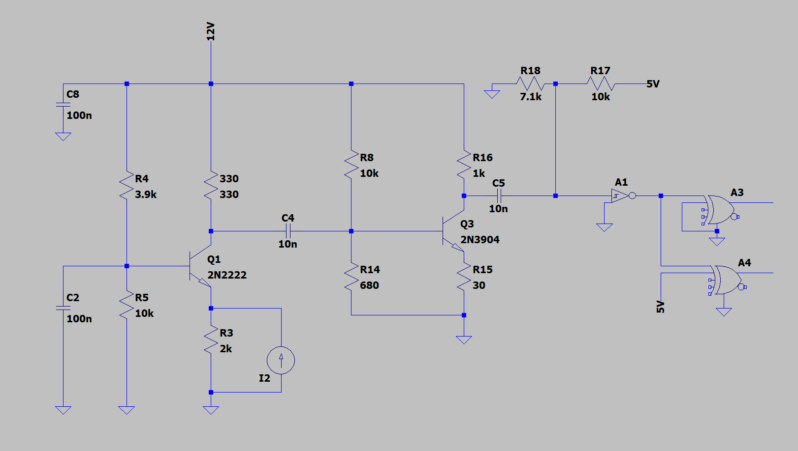 |

In the receiver simulation, two XOR gates stand in for the AM26C31 line driver (no simulation model was available). They produce the same pair of complementary outputs.

</details>

---

## PCB

| | |
|---|---|
| Size | 51.9 x 78.7 mm, chamfered corners, four 3 mm plated mounting holes tied to GND |
| Layers | 4 |
| L1 (top) | All components and all signal routing |
| L2 | Solid GND plane |
| L3 | Split power plane: 12 V and 5 V |
| L4 (bottom) | GND pour |
| Vias | 92 through vias (0.71 mm drill, 1.27 mm pad), including GND stitching along the board edges |
| Track widths | 7 to 50 mil (thin for signals, wide for power) |
| Design rules | 5 mil minimum clearance and width (a conservative preset) |
| Intended fab | JLCPCB, 4 layers, 1 oz copper |

| L1 top (components and routing) | L2 / L3 / L4 |
|---|---|
|  | 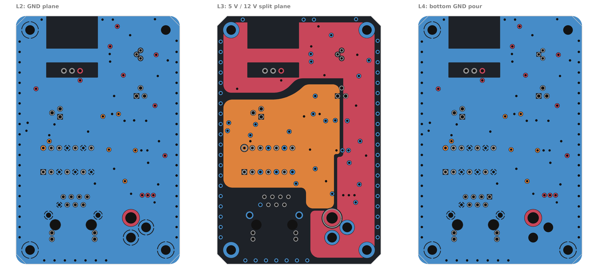 |

The PCB images are rendered straight from the saved `PCB1.PcbDoc` geometry, so they show the current layout. In the inner-layer view, blue is GND, red is 12 V and orange is 5 V.

---

## Bill of materials

Full list: [BOM.csv](BOM.csv)

| Qty | Designators | Part | Package |
|---:|---|---|---|
| 1 | U1 | 74HC14 hex Schmitt-trigger inverter | DIP-14 |
| 1 | U3 | AM26C31MDREP quad differential line driver (TI) | SOIC-16 |
| 1 | U6 | AMS1117-5.0, 5 V LDO | SOT-223 |
| 1 | CR3 | TL431AMFDT,215, 2.5 V shunt reference (Nexperia) | SOT-23 |
| 2 | U2, U4 | 2N3904 NPN | TO-92 |
| 1 | CR1 | 2N2222A NPN | TO-18 |
| 1 | D1 | 5 V laser diode module | 3-pin module |
| 1 | D2 | BPW34 PIN photodiode | through-hole |
| 1 | J1 | RAPC732X DC jack (Switchcraft) | through-hole |
| 1 | J2 | ARJM11C7-009-AB-EW2 RJ-45 MagJack (Abracon) | through-hole |
| 14 | C1 to C16 | Capacitors: 10 nF, 100 nF, 10 µF | 0805 / 1206 / tantalum case A |
| 22 | R1 to R40 | Resistors: 14 Ω to 10 kΩ | 0805 / 1206 |
| 9 | T1 to T10 | Test points on the key signal nodes | pad |

Designator numbers have gaps (for example no C14, no R15 to R17). The gaps are parts removed during the design, not missing parts.

---

## Opening the project

1. Install **Altium Designer** (the files were last saved with version 26).
2. Open `Ethernet to Laser.PrjPcb`. The schematic and PCB load with it.
3. Every symbol, footprint and 3D model used is in the two project libraries under `Libs/`. The 3D models are also embedded in `PCB1.PcbDoc`, so the 3D view works with no external files.

---

## Repository layout

```
Ethernet to Laser.PrjPcb            Altium project
Ethernet to Laser.PrjPcbStructure   Altium project structure file
Sheet1.SchDoc                       Schematic (one sheet, 8 hardware blocks)
PCB1.PcbDoc                         4-layer PCB layout
Libs/
  Ether to laser.SchLib             Schematic symbols used by the design
  Ether to laser.PcbLib             Footprints and 3D models used by the design
BOM.csv                             Bill of materials
docs/
  Ethernet_to_Laser_Circuit_Stages_and_Simulation.pdf
  images/schematic/                 Full schematic and one image per hardware block
  images/simulation/                LTspice circuits and waveforms
  images/pcb_top.png                Top layer
  images/pcb_inner_layers.png       L2, L3 and L4
```

---

## Status

- Schematic and 4-layer PCB layout are complete.
- Every stage has been simulated in LTspice (results above).
- The repository holds no bench measurements.

---

**Author:** Abdelrahman Refaat, Electronics and Communications Engineering, New Cairo Academy
